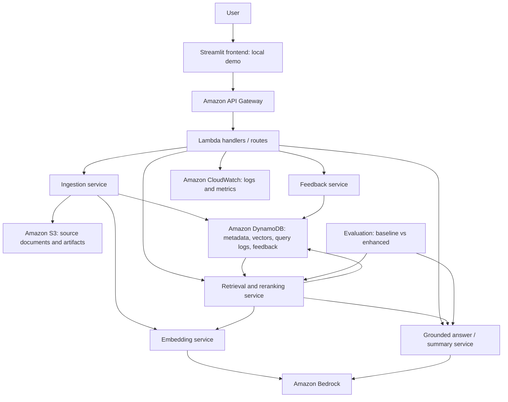

# Feedback-Enhanced GenAI Research Assistant on AWS

This project scaffold follows the capstone proposal, **Feedback-Enhanced GenAI Research Assistant Using Retrieval-Augmented Generation on AWS**. It organizes a low-cost application for uploading research documents, semantic search, grounded question answering, summarization, citations, and feedback-driven retrieval improvement.

The directory layout adopts the reference screenshot's `config`, `routes`, `schemas`, `services`, `storage`, and `utils` layers, with additional folders for the frontend, AWS infrastructure, prompts, data, evaluation, scripts, tests, and documentation. Every directory contains an English README describing its purpose.

This is a proposed architecture and documentation scaffold. Application code, dependency manifests, deployment templates, and cloud resources have not been created. Names such as `main.py` or individual service files are implementation choices for a later step.

## Directory Structure

```text
10.19/
├── README.md
├── config/
│   └── README.md
├── routes/
│   └── README.md
├── schemas/
│   └── README.md
├── services/
│   ├── README.md
│   ├── ingestion/
│   │   └── README.md
│   ├── embeddings/
│   │   └── README.md
│   ├── retrieval/
│   │   └── README.md
│   ├── generation/
│   │   └── README.md
│   └── feedback/
│       └── README.md
├── storage/
│   ├── README.md
│   ├── s3/
│   │   └── README.md
│   ├── dynamodb/
│   │   └── README.md
│   └── local/
│       └── README.md
├── utils/
│   └── README.md
├── frontend/
│   └── README.md
├── prompts/
│   └── README.md
├── infrastructure/
│   └── README.md
├── data/
│   ├── README.md
│   ├── raw/
│   │   └── README.md
│   ├── processed/
│   │   └── README.md
│   └── embeddings/
│       └── README.md
├── evaluation/
│   ├── README.md
│   ├── datasets/
│   │   └── README.md
│   └── results/
│       └── README.md
├── scripts/
│   └── README.md
├── tests/
│   └── README.md
├── docs/
│   └── README.md
```

## Proposed System Architecture



The diagram shows logical service responsibilities; it does not require a separate Lambda for every service. Backend packaging and handler boundaries will be selected during implementation. S3 upload events may invoke the ingestion handler, while API requests initiate uploads and report processing status. The frontend is initially a local Streamlit demo; hosted frontend infrastructure is not required for the first version.

## Main Workflows

1. **Ingestion:** upload PDF/text to S3, extract text with source locations, split into chunks, generate Bedrock embeddings, and persist metadata and vectors.
2. **Search and Q&A:** embed the question, compute cosine similarity over the small corpus, optionally rerank candidates with historical feedback, and send selected evidence to a Bedrock LLM. Return an answer with document/chunk citations.
3. **Summarization:** select a document's source chunks and generate a source-grounded summary with references.
4. **Feedback:** record helpful/unhelpful feedback against an answer or chunk, retain query and retrieval context, and update ranking aggregates. Define answer-to-chunk attribution before applying answer feedback to chunk scores.
5. **Evaluation:** compare semantic-only and feedback-enhanced retrieval using fixed questions, held-out relevance judgments, answer reviews, and citation checks.

## Initial Design Decisions

- Use Python with the proposal's S3, Bedrock, Lambda, API Gateway, DynamoDB, and CloudWatch stack.
- Start with approximately 20–50 documents and cosine similarity computed in application code. DynamoDB stores vectors and metadata; it is not treated as a native vector index.
- Cache embeddings and record model versions to avoid unnecessary Bedrock calls and incompatible vector comparisons.
- Keep the baseline score as semantic similarity. The initial enhanced scoring candidate is `semantic_similarity + feedback_weight * historical_feedback_score`; normalization, aggregation, and the weight must be documented and evaluated.
- Preserve stable document, chunk, query, and answer IDs and source locations so citations, feedback, and evaluations remain traceable.
- Use lightweight ranking adaptation without model training. Advanced bandits, multi-agent workflows, external academic search, SageMaker, and OpenSearch are outside the initial implementation scope.
- Keep credentials outside source control and record operational settings, usage, and errors through configuration and monitoring.

## Implementation Sequence

Follow the proposal's eight-week progression: finalize scope and corpus; implement parsing and chunking; add embeddings and persistence; build baseline RAG; add the frontend; collect feedback; implement reranking and comparative evaluation; complete testing, deployment documentation, report, slides, and demo.

The existing dataset preparation work in the sibling `../data/` directory is preserved. This project's `data/` directory is a separate destination for its selected corpus and generated artifacts.
